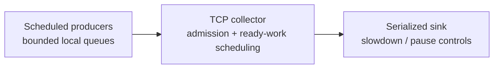

# Prento

**Timely telemetry under load.**

C++20 · Linux / TCP · Docker / OCI

[](https://github.com/sapenov/prento/actions/workflows/ci.yml)

When a telemetry pipeline backs up, critical failure signals arrive late—leaving engineers to diagnose a live incident with an incomplete picture.

Prento investigates how to get critical telemetry through sooner when ingestion is under pressure.

**Measured result:** priority-aware push cut mean critical end-to-end latency by **10.4% during bursts** and **13.3% with a slow sink**, versus FIFO push. Across **144 Docker trials**, all **79,236 synthetic messages completed after drain**, with no drops or unknown outcomes.

[View results](#results) · [Run the experiment](#quickstart) · [Explore the architecture](#architecture)

## Results


Each bar averages nine runs equally: three workload seeds × three timing repeats. The seed ranges show variation, not confidence intervals. [Compare all four scenarios, bulk costs and observed maxima](results/2026-11-04-qa/INTERPRETATION.md), or inspect the [complete report](results/2026-11-04-qa/REPORT.md).

Five-second offered-load windows plus drain; four CPUs and 1 GiB per container on a shared laptop. Runs contain 22–45 critical messages: these samples support descriptive mean comparisons, not a production tail SLO.

## Engineering findings

- **Use priority-aware push as the default for this workload.** Credits added coordination without a consistent end-to-end latency gain.
- **Measure the cost to other traffic.** Burst bulk mean latency rose 0.95%, and some critical messages took longer despite the lower mean.
- **Most remaining delay happens before transmission.** With priority-aware push, pre-send time accounts for 98.7% of critical mean latency in bursts and 98.1% with a slow sink. This interval includes producer FIFO waiting, scheduling lateness, preparation and connection setup.

## Quickstart

Run the full comparison with Docker Engine/Desktop (Linux containers) and Docker Compose. The image supplies the toolchain; the first build needs package-repository access unless cached.

```sh
docker compose --profile bench run --build --rm benchmark --output /results/run --seeds 7,42,2026 --repeats 3 --duration-ms 5000
```

The suite covers four scenarios × four modes × three seeds × three repeats, matching the published workload. The benchmark laptop completed the suite in about 15 minutes, excluding image-build time. Timings vary by host and run.

Results persist in the `bench-results` volume. Open the report to compare critical latency, bulk delay and completion outcomes:

```sh
docker compose --profile bench run --rm --entrypoint cat benchmark /results/run/REPORT.md
```

Repeat with a fresh output path, such as `/results/run-2`, in both commands. The runner protects existing results from overwriting. For native builds, the three-service demo and raw-data retrieval, see the [running guide](docs/RUNNING.md).

## Architecture

Scheduling chooses what goes next. Admission control limits how much payload enters the collector:



| | FIFO among fitting batches | Critical preference with bulk opportunities |
|---|---|---|
| Bounded push / TCP backpressure | `push/fifo` | `push/priority` |
| Explicit receiver-issued credits | `credit/fifo` | `credit/priority` |

All four modes share payloads, checksums, sink behavior and a **256 KiB collector reservation budget** in the recorded runs. Compare one axis at a time to measure each control's contribution. The budget caps reserved payload bytes; it does not bound process RSS or kernel buffering.

Receiver credits draw inspiration from Homa and run over TCP. Each producer exposes one outstanding batch per connection; batches are non-preemptive. [Protocol and measurement definitions](docs/METHODOLOGY.md).

## Validation and scope

Real TCP tests exercise corrupted payloads, backend loss, overload, shutdown and scheduling order. **18 core checks and 27 Python tests pass** in native, ASan/UBSan, TSan and Docker QA runs. Three independent mutations confirm that scheduling and credit tests detect deliberate defects. [Inspect the verification evidence](qa/VERIFICATION.md).

Traffic classes are synthetic labels. ACK means simulated sink processing, not durable storage. The [Kubernetes manifest](deploy/kubernetes.yaml) is a deployment example. Production adapters and multi-node scaling are future work. The published benchmark retains its [exact measured source and image provenance](qa/measurement-source/README.md).

## Next experiments

1. **Target the dominant delay:** instrument producer stages, then test producer-local priority under fixed budgets. [Options and effort estimates](docs/PRODUCER_LATENCY.md).
2. **Connect to existing pipelines:** add a standard telemetry adapter and compare against OpenTelemetry Collector.
3. **Measure operational limits:** extend workload duration and test on independent hosts with a durable backend.

## Documentation

- [Running guide](docs/RUNNING.md): Compose, native builds, metrics and Kubernetes examples.
- [Methodology](docs/METHODOLOGY.md): fair comparisons, latency accounting and completion semantics.
- [QA guide](qa/README.md): tests, raw evidence and reproduction. Build a checksummed source-and-evidence archive with `make qa-bundle`.
- [Engineering notes](docs/ENGINEERING.md) · [Architecture decisions](DESIGN.md) · [MIT license](LICENSE).

Created by [Khazretgali Sapenov](https://github.com/sapenov).

**Pronunciation:** PREN-to. **Intended association:** prompt delivery and operational readiness.
