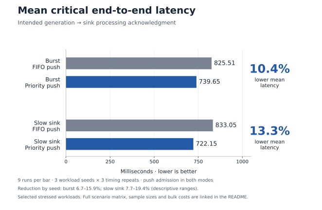
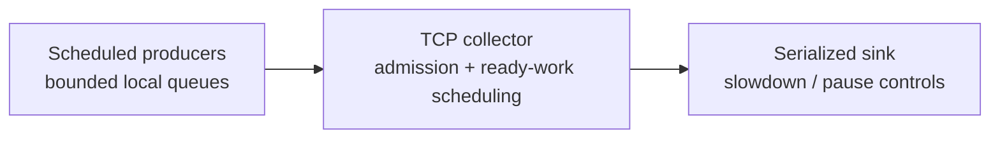

# Prento

**Timely telemetry under load.**

C++20 · Linux / TCP · Docker / OCI · Automated tests and CI

[](https://github.com/sapenov/prento/actions/workflows/ci.yml)

When a telemetry backend slows down, time-sensitive events can wait behind routine bulk data. Prento is a C++20 performance testbed for evaluating how scheduling and admission control affect that delay.

Across **144 Docker benchmark trials** and three workload seeds, priority-aware push reduced mean critical end-to-end latency by **10.4% during bursts** and **13.3% with a slow sink**, compared with FIFO push. All **79,236 synthetic messages completed after drain**, with no drops or unknown outcomes.

[View results](#results) · [Run the experiment](#quickstart) · [Explore the architecture](#architecture)

## Results



The chart highlights two stressed workloads. Each value averages nine runs equally: three seeds × three timing repeats. Seed ranges describe variation, not confidence intervals. [All four scenarios, bulk costs and observed maxima](results/2026-11-04-qa/INTERPRETATION.md) accompany the [complete report](results/2026-11-04-qa/REPORT.md).

**Measurement scope:** five-second offered-load windows plus drain; four CPUs and 1 GiB per container on a shared laptop. Each trial contains only 22–45 critical messages, so the results describe means and observed maxima rather than a production tail SLO. Completion acknowledges simulated sink processing.

## Engineering findings

- **Priority helped in the tested burst and slow-sink workloads.** Mean latency fell while some individual messages took longer; burst bulk mean latency increased 0.95%. The comparison keeps admission, workload and resource limits fixed.
- **Receiver credits offered no consistent additional benefit beyond priority-aware push.** The experiment makes their coordination cost and workload dependence visible, supporting the simpler policy for this workload.
- **The next bottleneck is upstream of transmission.** With priority-aware push, pre-send time accounts for 98.7% of critical mean latency in bursts and 98.1% with a slow sink. It includes producer FIFO waiting, scheduling lateness and preparation; finer instrumentation is needed to isolate each cause.

These findings guide the next experiment: measure producer stages and test source-local priority under the same queue and resource budgets. [Options and effort estimates](docs/PRODUCER_LATENCY.md).

## Quickstart

Requirements: Docker Engine/Desktop with Linux containers and Docker Compose. The image supplies the compiler and Python; the first build needs package-repository access unless cached.

```sh
docker compose --profile bench run --build --rm benchmark --output /results/run --seeds 7,42,2026 --repeats 3 --duration-ms 5000
```

This matches the published workload configuration: four scenarios × four modes × three seeds × three repeats. It took about 15 minutes on the measured laptop, plus image-build time. It uses the live Prento executable; the recorded results retain their [measured source and image identity](qa/measurement-source/README.md). Timings vary across machines and runs.

The runner prints per-trial generated/completed/drop/unknown counts and writes a report, latency chart, matched-message comparisons and raw outcomes to the `bench-results` volume. Read the report with:

```sh
docker compose --profile bench run --rm --entrypoint cat benchmark /results/run/REPORT.md
```

For another run, replace `/results/run` with a fresh path such as `/results/run-2` in both commands. Nonempty output directories are protected. See [native builds, the three-service demo and result retrieval](docs/RUNNING.md).

## Architecture



| | FIFO among fitting batches | Critical preference with bulk opportunities |
|---|---|---|
| Bounded push / TCP backpressure | `push/fifo` | `push/priority` |
| Explicit receiver-issued credits | `credit/fifo` | `credit/priority` |

The four modes isolate the effect of scheduling from the effect of explicit credits. Every mode uses full-batch collector reservations bounded by **256 KiB** in the recorded benchmark, identical payloads and checksums, and the same processing acknowledgments. This reservation budget does not cap process RSS or kernel buffers.

Application-layer receiver control draws inspiration from Homa; the implementation runs over TCP. Producers expose one outstanding batch per connection, and batches are non-preemptive. [Methodology, wire protocol and measurement definitions](docs/METHODOLOGY.md).

## Validation and scope

Real TCP integration tests cover accounting, admission order, ready-work scheduling and failure behavior. The recorded suite passes **18 core checks and 26 Python tests**, ASan/UBSan, TSan and three mutation checks. [Verification evidence](qa/VERIFICATION.md).

Traffic classes are synthetic labels. The custom protocol acknowledges processing rather than durable storage. The [Kubernetes manifest](deploy/kubernetes.yaml) is an illustrative deployment configuration; production adapters and multi-node scaling remain validation work.

## Next experiments

1. Instrument producer stages and evaluate producer-local priority.
2. Add a standard telemetry adapter and an OpenTelemetry Collector baseline.
3. Extend workload duration and test on independent hosts with a durable backend.

## Documentation

- [Run and deploy](docs/RUNNING.md): Compose, native builds, metrics and Kubernetes examples.
- [Methodology and protocol](docs/METHODOLOGY.md): fair comparisons, measurements and completion semantics.
- [QA guide](qa/README.md): tests, evidence map and reproduction. `make qa-bundle` packages source, documentation and preserved benchmark evidence with checksums.
- [Engineering notes](docs/ENGINEERING.md) · [Architecture decisions](DESIGN.md) · [MIT license](LICENSE).

Created by [Khazretgali Sapenov](https://github.com/sapenov).

**Pronunciation:** PREN-to. **Intended association:** prompt delivery and operational readiness.
