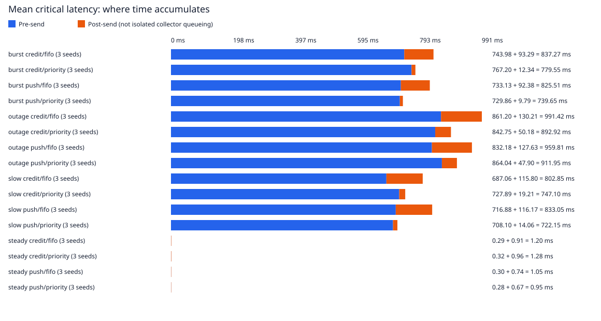

# Measured fan-in results

144 trials; workload seeds [7, 42, 2026]. Each run is weighted equally in mean breakdowns. Repeats of a seed are timing repeats, not new workloads.

Outcomes: 79236 generated; 79236 completed; 0 producer drops; 0 delivery-unknown outcomes.

Pre-send includes scheduled-generation lateness, producer queueing, payload preparation and connection setup. Post-send includes transfer, admission/ready-work waiting, sink processing and ACK. It is not an isolated collector-queue measurement.

Latency statistics describe completed messages. Read completion counts and per-seed variation alongside them. These finite laptop runs do not establish a production capacity or tail SLO.

## Mean critical-message latency breakdown

| Scenario | Mode | Critical completed / generated | Pre-send ms | Post-send ms | Total ms | Per-seed mean range ms |
|---|---|---:|---:|---:|---:|---:|
| burst | credit/fifo | 342/342 | 743.98 | 93.29 | 837.27 | 785.23–864.04 |
| burst | credit/priority | 342/342 | 767.20 | 12.34 | 779.55 | 724.30–873.82 |
| burst | push/fifo | 342/342 | 733.13 | 92.38 | 825.51 | 808.59–854.76 |
| burst | push/priority | 342/342 | 729.86 | 9.79 | 739.65 | 684.13–797.50 |
| outage | credit/fifo | 240/240 | 861.20 | 130.21 | 991.42 | 807.78–1139.57 |
| outage | credit/priority | 240/240 | 842.75 | 50.18 | 892.92 | 760.48–996.73 |
| outage | push/fifo | 240/240 | 832.18 | 127.63 | 959.81 | 809.39–1094.16 |
| outage | push/priority | 240/240 | 864.04 | 47.90 | 911.95 | 817.62–992.79 |
| slow | credit/fifo | 240/240 | 687.06 | 115.80 | 802.85 | 709.85–855.20 |
| slow | credit/priority | 240/240 | 727.89 | 19.21 | 747.10 | 655.76–793.71 |
| slow | push/fifo | 240/240 | 716.88 | 116.17 | 833.05 | 722.09–898.42 |
| slow | push/priority | 240/240 | 708.10 | 14.06 | 722.15 | 666.47–792.09 |
| steady | credit/fifo | 240/240 | 0.29 | 0.91 | 1.20 | 1.18–1.22 |
| steady | credit/priority | 240/240 | 0.32 | 0.96 | 1.28 | 1.07–1.49 |
| steady | push/fifo | 240/240 | 0.30 | 0.74 | 1.05 | 0.93–1.18 |
| steady | push/priority | 240/240 | 0.28 | 0.67 | 0.95 | 0.90–1.05 |

## Matched end-to-end comparisons

Inputs match by logical ID, producer, class, bytes and intended relative schedule within each scenario/seed/repeat. All completed pairs are retained; no post-hoc overload filter is used. Completion-status changes are recorded separately. Positive reduction favors the candidate. Percentages compare mean latencies, not mean per-message percentages. Per-seed ranges are descriptive, not confidence intervals.

| Scenario | Reference → candidate | Mean critical reduction % | Per-seed reduction range % | Faster critical / completed pairs |
|---|---|---:|---:|---:|
| burst | push/fifo → push/priority | 10.40 | 6.70–15.87 | 264/342 |
| burst | credit/fifo → credit/priority | 6.89 | -1.13–16.03 | 228/342 |
| burst | push/fifo → credit/fifo | -1.42 | -6.07–2.89 | 140/342 |
| burst | push/priority → credit/priority | -5.39 | -9.57–-0.43 | 114/342 |
| outage | push/fifo → push/priority | 4.99 | -1.02–9.26 | 154/240 |
| outage | credit/fifo → credit/priority | 9.93 | 5.86–12.53 | 209/240 |
| outage | push/fifo → credit/fifo | -3.29 | -5.23–0.20 | 85/240 |
| outage | push/priority → credit/priority | 2.09 | -0.40–6.99 | 128/240 |
| slow | push/fifo → push/priority | 13.31 | 7.70–19.43 | 189/240 |
| slow | credit/fifo → credit/priority | 6.94 | 5.90–7.62 | 164/240 |
| slow | push/fifo → credit/fifo | 3.62 | 1.69–4.81 | 160/240 |
| slow | push/priority → credit/priority | -3.45 | -12.12–1.61 | 102/240 |
| steady | push/fifo → push/priority | 9.32 | -12.58–23.70 | 121/240 |
| steady | credit/fifo → credit/priority | -6.65 | -23.45–12.49 | 115/240 |
| steady | push/fifo → credit/fifo | -14.67 | -29.15–-2.95 | 85/240 |
| steady | push/priority → credit/priority | -34.86 | -43.83–-18.06 | 94/240 |

Every matched message and interval appears in paired-messages.csv; paired-comparisons.json preserves per-run counts and statistics.

## Bulk-traffic cost

| Scenario | Mode | Bulk completed / generated | Bulk mean ms | Bulk observed maximum ms |
|---|---|---:|---:|---:|
| burst | credit/fifo | 5967/5967 | 806.74 | 1677.27 |
| burst | credit/priority | 5967/5967 | 838.14 | 1811.11 |
| burst | push/fifo | 5967/5967 | 795.30 | 1647.40 |
| burst | push/priority | 5967/5967 | 802.87 | 1886.66 |
| outage | credit/fifo | 4260/4260 | 906.55 | 1515.46 |
| outage | credit/priority | 4260/4260 | 891.04 | 1516.33 |
| outage | push/fifo | 4260/4260 | 877.90 | 1517.75 |
| outage | push/priority | 4260/4260 | 913.43 | 1552.52 |
| slow | credit/fifo | 4260/4260 | 735.31 | 1353.61 |
| slow | credit/priority | 4260/4260 | 777.24 | 1364.48 |
| slow | push/fifo | 4260/4260 | 762.06 | 1360.33 |
| slow | push/priority | 4260/4260 | 752.71 | 1357.83 |
| steady | credit/fifo | 4260/4260 | 9.23 | 26.75 |
| steady | credit/priority | 4260/4260 | 9.33 | 14.24 |
| steady | push/fifo | 4260/4260 | 9.09 | 17.79 |
| steady | push/priority | 4260/4260 | 9.07 | 23.40 |

## Interpretation and limits

A large post-send improvement may yield a smaller end-to-end improvement when producer-local head-of-line blocking dominates. Show means, observed maxima, completion counts and bulk cost together.

Empirical p99/p99.9 remain in JSON. p99_equals_max marks runs where nearest-rank p99 selects the observed maximum; the tables call that observation max. Short samples cannot establish stable tails.

Sink processing is serialized and non-preemptive. Slowdown and pause settings apply at batch entry; pauses do not model network partitions or durable-backend crashes. OS wake-up delays can extend requested sleeps. Compare datasets only after checking sink-timing behavior, load-window duration and backend settings against the recorded source and executable provenance; CSV format alone does not establish comparability.

Payload reservations do not cap process RSS or kernel socket buffering. Producer queues hold metadata; payloads are synthesized at send time. failed_unknown may include processing without an observed ACK; it is not known loss or exactly-once delivery.
