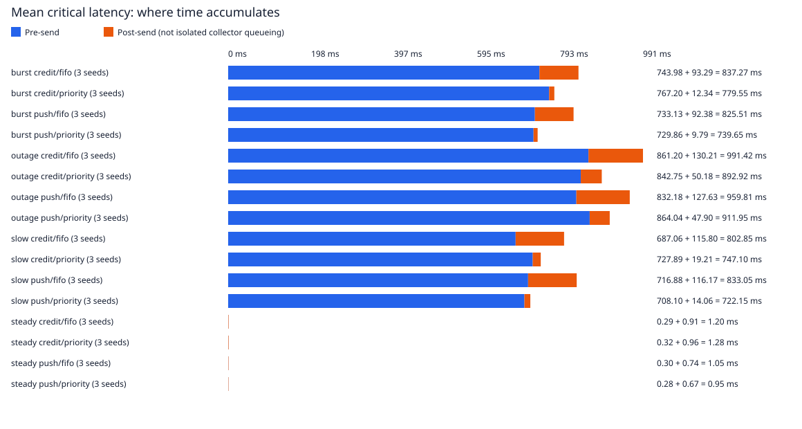

# Measured fan-in results

144 trials; workload seeds [7, 42, 2026]. Each run is weighted equally in mean breakdowns. Repeats of a seed are timing repeats, not new workloads.

Outcomes: 79236 generated; 79236 completed; 0 producer drops; 0 delivery-unknown outcomes.

Pre-send includes scheduled-generation lateness, producer queueing, payload preparation and connection setup. Post-send includes transfer, admission/ready-work waiting, sink processing and ACK. It is not an isolated collector-queue measurement.

Latency statistics describe completed messages. Read completion counts and per-seed variation alongside them. These finite laptop runs do not establish a production capacity or tail SLO.

## Mean critical-message latency breakdown

| Scenario | Mode | Critical completed / generated | Pre-send ms | Post-send ms | Total ms | Per-seed mean range ms |
|---|---|---:|---:|---:|---:|---:|
| burst | credit/fifo | 342/342 | 743.98 | 93.29 | 837.27 | 785.23–864.04 |
| burst | credit/priority | 342/342 | 767.20 | 12.34 | 779.55 | 724.30–873.82 |
| burst | push/fifo | 342/342 | 733.13 | 92.38 | 825.51 | 808.59–854.76 |
| burst | push/priority | 342/342 | 729.86 | 9.79 | 739.65 | 684.13–797.50 |
| outage | credit/fifo | 240/240 | 861.20 | 130.21 | 991.42 | 807.78–1139.57 |
| outage | credit/priority | 240/240 | 842.75 | 50.18 | 892.92 | 760.48–996.73 |
| outage | push/fifo | 240/240 | 832.18 | 127.63 | 959.81 | 809.39–1094.16 |
| outage | push/priority | 240/240 | 864.04 | 47.90 | 911.95 | 817.62–992.79 |
| slow | credit/fifo | 240/240 | 687.06 | 115.80 | 802.85 | 709.85–855.20 |
| slow | credit/priority | 240/240 | 727.89 | 19.21 | 747.10 | 655.76–793.71 |
| slow | push/fifo | 240/240 | 716.88 | 116.17 | 833.05 | 722.09–898.42 |
| slow | push/priority | 240/240 | 708.10 | 14.06 | 722.15 | 666.47–792.09 |
| steady | credit/fifo | 240/240 | 0.29 | 0.91 | 1.20 | 1.18–1.22 |
| steady | credit/priority | 240/240 | 0.32 | 0.96 | 1.28 | 1.07–1.49 |
| steady | push/fifo | 240/240 | 0.30 | 0.74 | 1.05 | 0.93–1.18 |
| steady | push/priority | 240/240 | 0.28 | 0.67 | 0.95 | 0.90–1.05 |

## Matched end-to-end comparisons

Inputs match by logical ID, producer, class, bytes and intended relative schedule within each scenario/seed/repeat. All completed pairs are retained; no post-hoc overload filter is used. Completion-status changes are recorded separately. Positive reduction favors the candidate. Percentages compare mean latencies, not mean per-message percentages. Per-seed ranges are descriptive, not confidence intervals.

| Scenario | Reference → candidate | Mean critical reduction % | Per-seed reduction range % | Faster critical / completed pairs |
|---|---|---:|---:|---:|
| burst | push/fifo → push/priority | 10.40 | 6.70–15.87 | 264/342 |
| burst | credit/fifo → credit/priority | 6.89 | -1.13–16.03 | 228/342 |
| burst | push/fifo → credit/fifo | -1.42 | -6.07–2.89 | 140/342 |
| burst | push/priority → credit/priority | -5.39 | -9.57–-0.43 | 114/342 |
| outage | push/fifo → push/priority | 4.99 | -1.02–9.26 | 154/240 |
| outage | credit/fifo → credit/priority | 9.93 | 5.86–12.53 | 209/240 |
| outage | push/fifo → credit/fifo | -3.29 | -5.23–0.20 | 85/240 |
| outage | push/priority → credit/priority | 2.09 | -0.40–6.99 | 128/240 |
| slow | push/fifo → push/priority | 13.31 | 7.70–19.43 | 189/240 |
| slow | credit/fifo → credit/priority | 6.94 | 5.90–7.62 | 164/240 |
| slow | push/fifo → credit/fifo | 3.62 | 1.69–4.81 | 160/240 |
| slow | push/priority → credit/priority | -3.45 | -12.12–1.61 | 102/240 |
| steady | push/fifo → push/priority | 9.32 | -12.58–23.70 | 121/240 |
| steady | credit/fifo → credit/priority | -6.65 | -23.45–12.49 | 115/240 |
| steady | push/fifo → credit/fifo | -14.67 | -29.15–-2.95 | 85/240 |
| steady | push/priority → credit/priority | -34.86 | -43.83–-18.06 | 94/240 |

Every matched message and interval appears in paired-messages.csv; paired-comparisons.json preserves per-run counts and statistics.

## Bulk-traffic cost

| Scenario | Mode | Bulk completed / generated | Bulk mean ms | Bulk observed maximum ms |
|---|---|---:|---:|---:|
| burst | credit/fifo | 5967/5967 | 806.74 | 1677.27 |
| burst | credit/priority | 5967/5967 | 838.14 | 1811.11 |
| burst | push/fifo | 5967/5967 | 795.30 | 1647.40 |
| burst | push/priority | 5967/5967 | 802.87 | 1886.66 |
| outage | credit/fifo | 4260/4260 | 906.55 | 1515.46 |
| outage | credit/priority | 4260/4260 | 891.04 | 1516.33 |
| outage | push/fifo | 4260/4260 | 877.90 | 1517.75 |
| outage | push/priority | 4260/4260 | 913.43 | 1552.52 |
| slow | credit/fifo | 4260/4260 | 735.31 | 1353.61 |
| slow | credit/priority | 4260/4260 | 777.24 | 1364.48 |
| slow | push/fifo | 4260/4260 | 762.06 | 1360.33 |
| slow | push/priority | 4260/4260 | 752.71 | 1357.83 |
| steady | credit/fifo | 4260/4260 | 9.23 | 26.75 |
| steady | credit/priority | 4260/4260 | 9.33 | 14.24 |
| steady | push/fifo | 4260/4260 | 9.09 | 17.79 |
| steady | push/priority | 4260/4260 | 9.07 | 23.40 |

## Per-run outcomes and observed maxima

| Scenario | Seed | Mode | Repeat | Critical n | Critical mean ms | Critical max ms | Drops | Unknown |
|---|---:|---|---:|---:|---:|---:|---:|---:|
| burst | 2026 | credit/fifo | 1 | 35/35 | 800.53 | 1538.37 | 0 | 0 |
| burst | 2026 | credit/fifo | 2 | 35/35 | 809.22 | 1531.98 | 0 | 0 |
| burst | 2026 | credit/fifo | 3 | 35/35 | 745.94 | 1438.55 | 0 | 0 |
| burst | 2026 | credit/priority | 1 | 35/35 | 750.09 | 1529.25 | 0 | 0 |
| burst | 2026 | credit/priority | 2 | 35/35 | 737.98 | 1521.06 | 0 | 0 |
| burst | 2026 | credit/priority | 3 | 35/35 | 733.47 | 1507.49 | 0 | 0 |
| burst | 2026 | push/fifo | 1 | 35/35 | 847.81 | 1573.42 | 0 | 0 |
| burst | 2026 | push/fifo | 2 | 35/35 | 776.15 | 1496.62 | 0 | 0 |
| burst | 2026 | push/fifo | 3 | 35/35 | 801.80 | 1513.90 | 0 | 0 |
| burst | 2026 | push/priority | 1 | 35/35 | 816.20 | 1589.99 | 0 | 0 |
| burst | 2026 | push/priority | 2 | 35/35 | 661.46 | 1399.74 | 0 | 0 |
| burst | 2026 | push/priority | 3 | 35/35 | 734.35 | 1467.94 | 0 | 0 |
| burst | 42 | credit/fifo | 1 | 34/34 | 795.96 | 1488.89 | 0 | 0 |
| burst | 42 | credit/fifo | 2 | 34/34 | 863.89 | 1578.02 | 0 | 0 |
| burst | 42 | credit/fifo | 3 | 34/34 | 932.28 | 1649.55 | 0 | 0 |
| burst | 42 | credit/priority | 1 | 34/34 | 850.33 | 1581.11 | 0 | 0 |
| burst | 42 | credit/priority | 2 | 34/34 | 875.23 | 1622.69 | 0 | 0 |
| burst | 42 | credit/priority | 3 | 34/34 | 895.90 | 1671.07 | 0 | 0 |
| burst | 42 | push/fifo | 1 | 34/34 | 870.88 | 1622.30 | 0 | 0 |
| burst | 42 | push/fifo | 2 | 34/34 | 846.04 | 1545.64 | 0 | 0 |
| burst | 42 | push/fifo | 3 | 34/34 | 847.35 | 1553.82 | 0 | 0 |
| burst | 42 | push/priority | 1 | 34/34 | 777.62 | 1500.98 | 0 | 0 |
| burst | 42 | push/priority | 2 | 34/34 | 745.53 | 1456.98 | 0 | 0 |
| burst | 42 | push/priority | 3 | 34/34 | 869.34 | 1649.06 | 0 | 0 |
| burst | 7 | credit/fifo | 1 | 45/45 | 854.11 | 1500.02 | 0 | 0 |
| burst | 7 | credit/fifo | 2 | 45/45 | 846.33 | 1495.37 | 0 | 0 |
| burst | 7 | credit/fifo | 3 | 45/45 | 887.19 | 1532.81 | 0 | 0 |
| burst | 7 | credit/priority | 1 | 45/45 | 721.38 | 1495.87 | 0 | 0 |
| burst | 7 | credit/priority | 2 | 45/45 | 724.15 | 1472.79 | 0 | 0 |
| burst | 7 | credit/priority | 3 | 45/45 | 727.38 | 1457.83 | 0 | 0 |
| burst | 7 | push/fifo | 1 | 45/45 | 840.10 | 1470.59 | 0 | 0 |
| burst | 7 | push/fifo | 2 | 45/45 | 806.44 | 1435.25 | 0 | 0 |
| burst | 7 | push/fifo | 3 | 45/45 | 793.01 | 1388.87 | 0 | 0 |
| burst | 7 | push/priority | 1 | 45/45 | 670.03 | 1346.59 | 0 | 0 |
| burst | 7 | push/priority | 2 | 45/45 | 684.52 | 1364.10 | 0 | 0 |
| burst | 7 | push/priority | 3 | 45/45 | 697.83 | 1366.07 | 0 | 0 |
| outage | 2026 | credit/fifo | 1 | 25/25 | 1164.70 | 1485.62 | 0 | 0 |
| outage | 2026 | credit/fifo | 2 | 25/25 | 1093.87 | 1509.47 | 0 | 0 |
| outage | 2026 | credit/fifo | 3 | 25/25 | 1160.16 | 1504.66 | 0 | 0 |
| outage | 2026 | credit/priority | 1 | 25/25 | 996.87 | 1467.16 | 0 | 0 |
| outage | 2026 | credit/priority | 2 | 25/25 | 971.49 | 1461.67 | 0 | 0 |
| outage | 2026 | credit/priority | 3 | 25/25 | 1021.83 | 1464.38 | 0 | 0 |
| outage | 2026 | push/fifo | 1 | 25/25 | 1088.01 | 1498.19 | 0 | 0 |
| outage | 2026 | push/fifo | 2 | 25/25 | 1094.92 | 1502.48 | 0 | 0 |
| outage | 2026 | push/fifo | 3 | 25/25 | 1099.54 | 1489.95 | 0 | 0 |
| outage | 2026 | push/priority | 1 | 25/25 | 1041.10 | 1458.04 | 0 | 0 |
| outage | 2026 | push/priority | 2 | 25/25 | 963.63 | 1457.19 | 0 | 0 |
| outage | 2026 | push/priority | 3 | 25/25 | 973.62 | 1458.55 | 0 | 0 |
| outage | 42 | credit/fifo | 1 | 22/22 | 798.04 | 1453.14 | 0 | 0 |
| outage | 42 | credit/fifo | 2 | 22/22 | 838.49 | 1471.84 | 0 | 0 |
| outage | 42 | credit/fifo | 3 | 22/22 | 786.81 | 1455.49 | 0 | 0 |
| outage | 42 | credit/priority | 1 | 22/22 | 737.65 | 1337.34 | 0 | 0 |
| outage | 42 | credit/priority | 2 | 22/22 | 787.82 | 1363.37 | 0 | 0 |
| outage | 42 | credit/priority | 3 | 22/22 | 755.97 | 1341.99 | 0 | 0 |
| outage | 42 | push/fifo | 1 | 22/22 | 818.01 | 1461.11 | 0 | 0 |
| outage | 42 | push/fifo | 2 | 22/22 | 812.08 | 1471.33 | 0 | 0 |
| outage | 42 | push/fifo | 3 | 22/22 | 798.08 | 1474.40 | 0 | 0 |
| outage | 42 | push/priority | 1 | 22/22 | 836.54 | 1348.42 | 0 | 0 |
| outage | 42 | push/priority | 2 | 22/22 | 854.58 | 1391.17 | 0 | 0 |
| outage | 42 | push/priority | 3 | 22/22 | 761.73 | 1346.16 | 0 | 0 |
| outage | 7 | credit/fifo | 1 | 33/33 | 1008.77 | 1458.07 | 0 | 0 |
| outage | 7 | credit/fifo | 2 | 33/33 | 1079.07 | 1475.60 | 0 | 0 |
| outage | 7 | credit/fifo | 3 | 33/33 | 992.84 | 1456.97 | 0 | 0 |
| outage | 7 | credit/priority | 1 | 33/33 | 923.44 | 1361.65 | 0 | 0 |
| outage | 7 | credit/priority | 2 | 33/33 | 948.23 | 1340.14 | 0 | 0 |
| outage | 7 | credit/priority | 3 | 33/33 | 893.03 | 1368.58 | 0 | 0 |
| outage | 7 | push/fifo | 1 | 33/33 | 950.77 | 1452.00 | 0 | 0 |
| outage | 7 | push/fifo | 2 | 33/33 | 961.36 | 1459.85 | 0 | 0 |
| outage | 7 | push/fifo | 3 | 33/33 | 1015.55 | 1484.38 | 0 | 0 |
| outage | 7 | push/priority | 1 | 33/33 | 888.21 | 1329.47 | 0 | 0 |
| outage | 7 | push/priority | 2 | 33/33 | 907.22 | 1349.76 | 0 | 0 |
| outage | 7 | push/priority | 3 | 33/33 | 980.89 | 1400.66 | 0 | 0 |
| slow | 2026 | credit/fifo | 1 | 25/25 | 834.47 | 1288.64 | 0 | 0 |
| slow | 2026 | credit/fifo | 2 | 25/25 | 830.76 | 1286.66 | 0 | 0 |
| slow | 2026 | credit/fifo | 3 | 25/25 | 865.27 | 1306.54 | 0 | 0 |
| slow | 2026 | credit/priority | 1 | 25/25 | 768.26 | 1214.60 | 0 | 0 |
| slow | 2026 | credit/priority | 2 | 25/25 | 794.97 | 1203.19 | 0 | 0 |
| slow | 2026 | credit/priority | 3 | 25/25 | 817.89 | 1230.25 | 0 | 0 |
| slow | 2026 | push/fifo | 1 | 25/25 | 928.12 | 1314.81 | 0 | 0 |
| slow | 2026 | push/fifo | 2 | 25/25 | 856.93 | 1298.17 | 0 | 0 |
| slow | 2026 | push/fifo | 3 | 25/25 | 850.85 | 1290.63 | 0 | 0 |
| slow | 2026 | push/priority | 1 | 25/25 | 717.05 | 1207.13 | 0 | 0 |
| slow | 2026 | push/priority | 2 | 25/25 | 681.60 | 1183.32 | 0 | 0 |
| slow | 2026 | push/priority | 3 | 25/25 | 725.06 | 1202.61 | 0 | 0 |
| slow | 42 | credit/fifo | 1 | 22/22 | 685.02 | 1292.97 | 0 | 0 |
| slow | 42 | credit/fifo | 2 | 22/22 | 721.23 | 1297.46 | 0 | 0 |
| slow | 42 | credit/fifo | 3 | 22/22 | 723.32 | 1309.22 | 0 | 0 |
| slow | 42 | credit/priority | 1 | 22/22 | 718.74 | 1210.84 | 0 | 0 |
| slow | 42 | credit/priority | 2 | 22/22 | 624.94 | 1157.11 | 0 | 0 |
| slow | 42 | credit/priority | 3 | 22/22 | 623.61 | 1181.55 | 0 | 0 |
| slow | 42 | push/fifo | 1 | 22/22 | 685.70 | 1297.68 | 0 | 0 |
| slow | 42 | push/fifo | 2 | 22/22 | 730.42 | 1340.55 | 0 | 0 |
| slow | 42 | push/fifo | 3 | 22/22 | 750.15 | 1318.76 | 0 | 0 |
| slow | 42 | push/priority | 1 | 22/22 | 661.55 | 1193.41 | 0 | 0 |
| slow | 42 | push/priority | 2 | 22/22 | 670.32 | 1193.68 | 0 | 0 |
| slow | 42 | push/priority | 3 | 22/22 | 667.54 | 1178.41 | 0 | 0 |
| slow | 7 | credit/fifo | 1 | 33/33 | 846.46 | 1300.65 | 0 | 0 |
| slow | 7 | credit/fifo | 2 | 33/33 | 855.12 | 1318.32 | 0 | 0 |
| slow | 7 | credit/fifo | 3 | 33/33 | 864.03 | 1331.54 | 0 | 0 |
| slow | 7 | credit/priority | 1 | 33/33 | 784.86 | 1194.20 | 0 | 0 |
| slow | 7 | credit/priority | 2 | 33/33 | 784.11 | 1183.68 | 0 | 0 |
| slow | 7 | credit/priority | 3 | 33/33 | 806.51 | 1192.81 | 0 | 0 |
| slow | 7 | push/fifo | 1 | 33/33 | 943.03 | 1347.12 | 0 | 0 |
| slow | 7 | push/fifo | 2 | 33/33 | 880.82 | 1333.75 | 0 | 0 |
| slow | 7 | push/fifo | 3 | 33/33 | 871.41 | 1297.94 | 0 | 0 |
| slow | 7 | push/priority | 1 | 33/33 | 775.46 | 1193.91 | 0 | 0 |
| slow | 7 | push/priority | 2 | 33/33 | 801.84 | 1181.57 | 0 | 0 |
| slow | 7 | push/priority | 3 | 33/33 | 798.98 | 1197.70 | 0 | 0 |
| steady | 2026 | credit/fifo | 1 | 25/25 | 1.47 | 2.64 | 0 | 0 |
| steady | 2026 | credit/fifo | 2 | 25/25 | 1.61 | 2.93 | 0 | 0 |
| steady | 2026 | credit/fifo | 3 | 25/25 | 0.58 | 0.69 | 0 | 0 |
| steady | 2026 | credit/priority | 1 | 25/25 | 1.28 | 2.24 | 0 | 0 |
| steady | 2026 | credit/priority | 2 | 25/25 | 1.37 | 3.01 | 0 | 0 |
| steady | 2026 | credit/priority | 3 | 25/25 | 0.54 | 0.71 | 0 | 0 |
| steady | 2026 | push/fifo | 1 | 25/25 | 1.39 | 2.40 | 0 | 0 |
| steady | 2026 | push/fifo | 2 | 25/25 | 1.63 | 2.54 | 0 | 0 |
| steady | 2026 | push/fifo | 3 | 25/25 | 0.53 | 1.94 | 0 | 0 |
| steady | 2026 | push/priority | 1 | 25/25 | 0.94 | 2.07 | 0 | 0 |
| steady | 2026 | push/priority | 2 | 25/25 | 0.73 | 1.94 | 0 | 0 |
| steady | 2026 | push/priority | 3 | 25/25 | 1.03 | 2.13 | 0 | 0 |
| steady | 42 | credit/fifo | 1 | 22/22 | 1.03 | 2.71 | 0 | 0 |
| steady | 42 | credit/fifo | 2 | 22/22 | 0.53 | 0.61 | 0 | 0 |
| steady | 42 | credit/fifo | 3 | 22/22 | 1.99 | 3.18 | 0 | 0 |
| steady | 42 | credit/priority | 1 | 22/22 | 1.82 | 2.87 | 0 | 0 |
| steady | 42 | credit/priority | 2 | 22/22 | 1.39 | 2.43 | 0 | 0 |
| steady | 42 | credit/priority | 3 | 22/22 | 0.66 | 2.36 | 0 | 0 |
| steady | 42 | push/fifo | 1 | 22/22 | 0.56 | 1.06 | 0 | 0 |
| steady | 42 | push/fifo | 2 | 22/22 | 1.36 | 2.46 | 0 | 0 |
| steady | 42 | push/fifo | 3 | 22/22 | 1.16 | 2.02 | 0 | 0 |
| steady | 42 | push/priority | 1 | 22/22 | 0.89 | 2.25 | 0 | 0 |
| steady | 42 | push/priority | 2 | 22/22 | 1.07 | 2.28 | 0 | 0 |
| steady | 42 | push/priority | 3 | 22/22 | 0.73 | 1.59 | 0 | 0 |
| steady | 7 | credit/fifo | 1 | 33/33 | 0.98 | 2.57 | 0 | 0 |
| steady | 7 | credit/fifo | 2 | 33/33 | 1.48 | 2.86 | 0 | 0 |
| steady | 7 | credit/fifo | 3 | 33/33 | 1.16 | 2.85 | 0 | 0 |
| steady | 7 | credit/priority | 1 | 33/33 | 1.63 | 3.13 | 0 | 0 |
| steady | 7 | credit/priority | 2 | 33/33 | 1.96 | 2.95 | 0 | 0 |
| steady | 7 | credit/priority | 3 | 33/33 | 0.87 | 2.07 | 0 | 0 |
| steady | 7 | push/fifo | 1 | 33/33 | 0.50 | 0.95 | 0 | 0 |
| steady | 7 | push/fifo | 2 | 33/33 | 1.39 | 2.67 | 0 | 0 |
| steady | 7 | push/fifo | 3 | 33/33 | 0.91 | 2.14 | 0 | 0 |
| steady | 7 | push/priority | 1 | 33/33 | 1.28 | 3.27 | 0 | 0 |
| steady | 7 | push/priority | 2 | 33/33 | 0.57 | 2.02 | 0 | 0 |
| steady | 7 | push/priority | 3 | 33/33 | 1.30 | 2.62 | 0 | 0 |

## Interpretation and limits

A large post-send improvement may yield a smaller end-to-end improvement when producer-local head-of-line blocking dominates. Show means, observed maxima, completion counts and bulk cost together.

Empirical p99/p99.9 remain in JSON. p99_equals_max marks runs where nearest-rank p99 selects the observed maximum; the tables call that observation max. Short samples cannot establish stable tails.

Establish the timer model from binary/source provenance: historical evidence predates the timer fix, while corrected-timer evidence uses remaining-time bounded sleeps. This reporter does not infer timer behavior from CSV format. OS wake-up delays remain. Slowdown/pause changes act at batch entry and processing is non-preemptive. A pause is not a network partition or durability model. Do not mix timer versions.

Payload reservations do not cap process RSS or kernel socket buffering. Producer queues hold metadata; payloads are synthesized at send time. failed_unknown may include processing without an observed ACK; it is not known loss or exactly-once delivery.
